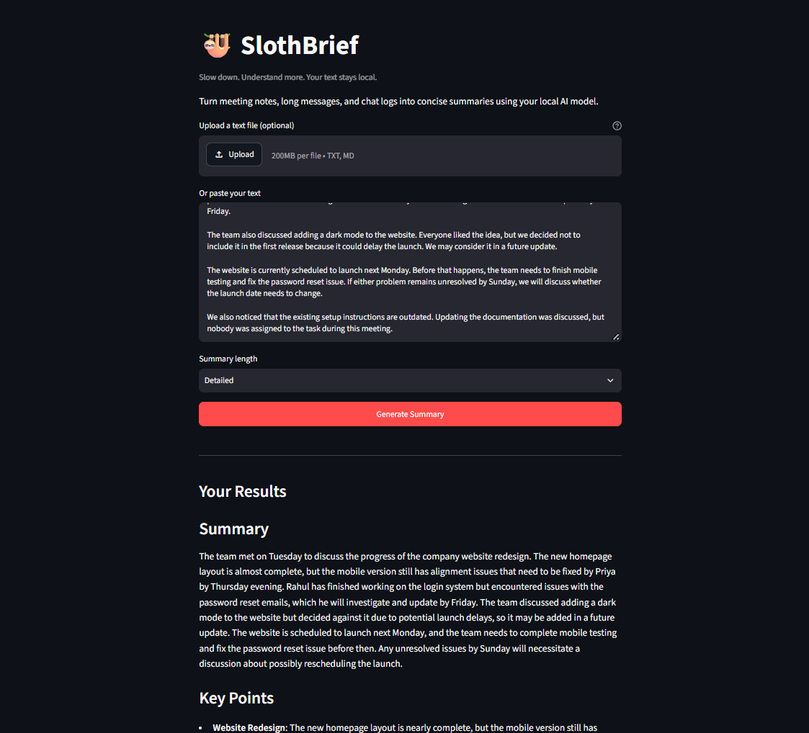
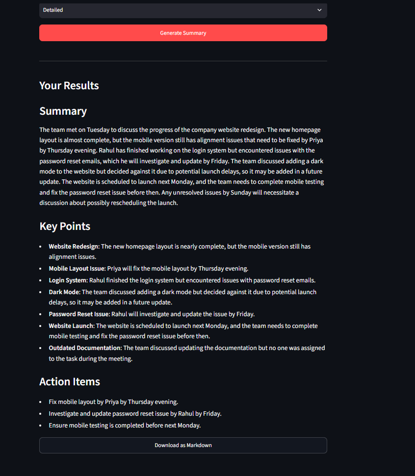

# SlothBrief 🦥

SlothBrief turns meeting notes and other text into a summary, key points, and action items using a local AI model.

It runs through Ollama, so you don't need a paid cloud AI API.

## Features

- Summarize pasted text
- Upload `.txt` and `.md` files
- Choose a short, balanced, or detailed summary
- Extract key points and action items
- Download summaries as Markdown
- Run the model locally





## Requirements

- Python 3.12 or compatible Python version
- [Ollama](https://ollama.com/)
- The `qwen2.5:1.5b` model

## Setup

Pull the model:

```powershell
ollama pull qwen2.5:1.5b
```

Clone the repository and enter its folder:

```powershell
git clone https://github.com/Aayush4518/slothbrief.git
cd slothbrief
```

Create and activate a virtual environment on Windows:

```powershell
python -m venv .venv
.\.venv\Scripts\Activate.ps1
```

Install the dependencies:

```powershell
python -m pip install -r requirements.txt
```

## Run

Make sure Ollama is running, then start the app:

```powershell
python -m streamlit run app.py
```

Open the local URL shown in the terminal.

## Tests

Run the automated tests:

```powershell
python -m pytest -v
```

The tests mock the Ollama HTTP requests, so they don't need to generate real AI responses.

## Privacy

Text is sent to the Ollama service running on your machine for summarization. SlothBrief does not use a cloud AI API.

Ollama and the model must be installed first. Downloading them requires internet access.

## Limitations

- Summary quality depends on the model.
- Action items may need manual review.
- Very long documents may take longer to process or exceed the model's context limit.

## Project structure

```text
slothbrief/
├── app.py
├── requirements.txt
├── src/
│   └── slothbrief/
│       ├── __init__.py
│       ├── file_reader.py
│       ├── ollama_client.py
│       └── summarizer.py
├── tests/
├── samples/
└── docs/
```
